<div align="center">


# RejBoard

**A local-first whiteboard and handwriting note-taking app.**
Write, sketch, annotate PDFs and record lectures. No account, no cloud, no subscription.

[](CHANGELOG.md)
[](LICENSE)
[](https://github.com/RejwanShafi25/RejBoard/releases/latest)
[](https://rejwanshafi25.github.io/RejBoard/)

[Download](https://github.com/RejwanShafi25/RejBoard/releases/latest) ·
[Web app](https://rejwanshafi25.github.io/RejBoard/) ·
[Changelog](CHANGELOG.md) ·
[Report an issue](https://github.com/RejwanShafi25/RejBoard/issues)

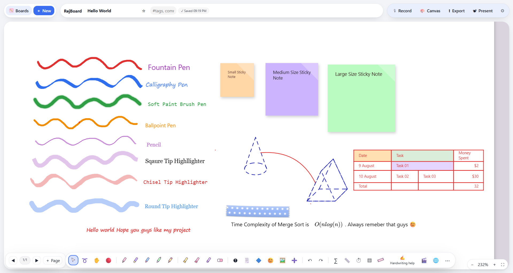

</div>

---

## Contents

- [Overview](#overview)
- [Highlights](#highlights)
- [Installation](#installation)
- [Privacy and data handling](#privacy-and-data-handling)
- [Feature reference](#feature-reference)
- [Architecture](#architecture)
- [Development](#development)
- [Build and release](#build-and-release)
- [Localization](#localization)
- [Known limitations](#known-limitations)
- [Roadmap](#roadmap)
- [Contributing](#contributing)
- [License and credits](#license-and-credits)

---

## Overview

RejBoard is a handwriting-first note-taking app for people who think on paper: students, engineers, teachers and anyone who sketches ideas before typing them. It combines a pressure-sensitive pen engine with typed text, LaTeX math, shapes and connectors, tables with spreadsheet formulas, PDF annotation and per-board voice recordings.

Everything runs on your device. Boards live in local storage (IndexedDB in the browser, the app-data folder on desktop), and nothing is sent anywhere unless you explicitly use one of the [optional online features](#privacy-and-data-handling).

### Design principles

| Principle | What it means in practice |
|---|---|
| **Local-first** | No account, no sync service, no analytics. Your data is yours. |
| **Free and open source** | MIT licensed. No paywalled features, no subscriptions. |
| **Handwriting first** | Low-latency, pressure-sensitive ink, with palm rejection, tilt shading and stylus button support. |
| **Offline by default** | Drawing, text, math, tables, PDF, export and recordings all work without a connection. |

### Why it exists

I take most of my notes by hand on an Android tablet. The Android ecosystem has no shortage of handwriting apps, and each one does something well: one has an excellent pen engine, another has useful organization tools, a third handles PDFs cleverly. The problem is that the best features are usually locked behind a paywall or a subscription, and buying every app would cost far more than I was willing to spend. On top of that, most of these apps keep your notes in their own cloud.

I wanted something different: a handwriting note-taking app that is free, open source and fully local, where your notes live on your device and nowhere else. I also wanted to use it on Windows, where, apart from OneNote, there are few handwriting-first note apps.

To get there, I studied the most useful features of note-taking apps on Android, iPadOS (which I tested for a few days) and Windows, and set out to bring them together in one app.

---

## Highlights

<table>
<tr>
<td width="50%" valign="top">

**Ink and drawing**
- Fountain, calligraphy, brush, ballpoint and pencil pens
- Three highlighter nibs, tapes, laser pointer
- Sketch-and-snap shape recognition
- Dynamic connectors that follow shapes
- Layers, transparent ruler, palm rejection

</td>
<td width="50%" valign="top">

**Documents and structure**
- Infinite canvas or A4 / A5 / A3 / Letter pages
- PDF import and annotation
- Word / PowerPoint import
- Tables with merged cells and 50+ formula functions
- Board-to-board links with `@`

</td>
</tr>
<tr>
<td valign="top">

**Capture and share**
- Per-board voice recordings
- Export to PNG, SVG, PDF and `.rjwb`
- Encrypted board transfer on your LAN
- Full backup and restore

</td>
<td valign="top">

**Organization**
- Nested folders, tags, favorites, Trash
- Password-protected boards
- Search across titles, text and tags
- Multi-select actions and drag-to-move

</td>
</tr>
<tr>
<td valign="top">

**Handwriting to text**
- Online engine (Google) for cursive
- On-device engine (bundled Tesseract.js) for fully offline use

</td>
<td valign="top">

**Global by design**
- 22 interface languages, including RTL layouts
- Light and dark themes with automatic ink contrast
- Responsive from desktop to phone-sized windows

</td>
</tr>
</table>

---

## Installation

### Desktop (recommended)

Download the installer for your platform from the [latest release](https://github.com/RejwanShafi25/RejBoard/releases/latest).

| Platform | Artifacts |
|---|---|
| **Windows** (x64) | `RejBoard-<version>-win-x64-Setup.exe`, `RejBoard-<version>-win-x64-Portable.exe` |
| **macOS** (Intel and Apple Silicon) | `RejBoard-<version>-mac-<arch>.dmg` |
| **Linux** | `.AppImage`, `.deb`, `.rpm` |

> **Unsigned builds.** Release builds are not code-signed yet. On Windows, SmartScreen may warn you (*More info → Run anyway*). On macOS, if the app is reported as damaged, run:
> ```bash
> xattr -cr "/Applications/RejBoard.app"
> ```

### Web app (PWA)

Open **https://rejwanshafi25.github.io/RejBoard/**, then use your browser's install option (the icon in Chrome or Edge's address bar) to install it as an offline app.

The web build stores boards in your browser's IndexedDB, so they are not shared between devices or browsers. The desktop app is the better choice for long-term storage, and it also unlocks the in-app browser, on-device handwriting recognition and local-network sharing.

### Where is my data stored?

| Build | Location | Notes |
|---|---|---|
| Desktop | The app's user-data folder | Existing `Rejwan Whiteboard` data folders are detected and reused, so boards survive the rename. |
| Web / PWA | Browser IndexedDB | Clearing *cached images and files* is safe. Clearing *cookies and other site data* **deletes your boards**. |

Use **Backup** on the home screen regularly. Backups include voice recordings.

---

## Privacy and data handling

RejBoard has no account system, no telemetry and no analytics. Only the optional features below use the network.

| Feature | Network | What leaves your device |
|---|---|---|
| Drawing, text, math, tables, PDF, export, recordings | None | Nothing |
| Handwriting to text, **On-device** engine | None | Nothing. Strokes are rasterized in memory, recognized by a bundled engine and discarded. |
| Handwriting to text, **Online** engine (default) | Required | The ink points of the selected strokes, sent to an unofficial Google Input Tools endpoint. |
| In-app browser and video panel (desktop) | Required | Whatever you browse. See the notes below. |
| UI language packs | Once per language, if not bundled | A request for a pack file from this repository. Nothing about you is sent. |
| Local-network sharing | LAN only | Boards you choose to send, encrypted in transit, to a computer you select. |
| Update check (desktop, opt-in) | HTTPS to GitHub Releases | Your IP address and installed app version. Only when you press **Check for updates** or enable **Check for updates automatically** in Settings → Updates. Automatic checks are off by default. |

### Desktop app updates

In **Settings → Updates**, check manually or enable optional startup checks (off by default). Update metadata and downloads come from GitHub Releases over HTTPS. Windows NSIS installers and Linux AppImage builds support in-app updates with differential downloads where the release blockmaps allow it. Windows Portable builds and Linux `.deb`/`.rpm` packages must be updated manually from [GitHub Releases](https://github.com/RejwanShafi25/RejBoard/releases/latest). Unsigned macOS builds also use the Releases page. Update checks disclose the request IP address and app version to GitHub; no board content is sent.

**Enabling macOS auto-updates later:** (1) enrol in the Apple Developer Program; (2) create a Developer ID Application certificate and securely export it as a `.p12`; (3) configure signing and hardened runtime entitlements, then notarize and staple the app; (4) add the certificate and password as encrypted CI secrets (for example `CSC_LINK` and `CSC_KEY_PASSWORD`) and provide Apple notarization credentials as GitHub Actions secrets; (5) enable signed macOS builds and verify the signed `.app` and ZIP on a clean Mac. Never turn off signature verification. The ZIP target is already configured alongside DMG for this preparation.

### Handwriting to text

Select handwriting with the lasso and press **✍→T**. Choose an engine in *Settings → Handwriting to text*.

| | Online (Google) | On-device (offline) |
|---|---|---|
| Availability | Desktop and web | Desktop only |
| Best for | Cursive and mixed handwriting | Neat or printed handwriting |
| Network | Required | None |
| Mechanism | Sends ink points to a Google service | Draws strokes to an in-memory PNG, recognized by bundled Tesseract.js (WebAssembly). No temp files, no API keys. |
| Engine consistency | n/a | Identical on Windows, macOS and Linux. The operating system's OCR is not used. |

Every release build ships the on-device engine with English language data, so it works with nothing extra to install.

### Local-network sharing

Available in the desktop app, between Windows, macOS and Linux machines on the same network.

1. On the receiving computer, enable **Receive boards on this computer**.
2. On the sending computer, select boards, choose the receiver (or enter its IP) and press **Send**.
3. Both screens show the same 6-digit security code. The receiver verifies it matches and presses **Accept**.

Received boards are placed in a folder named *Received from `<computer>`*.

**Security model**

- Each transfer performs a fresh **X25519** key exchange, derives per-direction keys with **HKDF-SHA-256**, and encrypts every frame with **AES-256-GCM** (authenticated, tamper-evident).
- The 6-digit code is derived from the key exchange and must be confirmed on both screens, which defends against a man-in-the-middle.
- Encryption protects data **in transit only**. Boards are stored as ordinary boards on both machines.
- Receiving is **off by default**, and nothing is announced on the network until you enable it. Discovery uses UDP `41234`; transfer uses TCP `41235`. Your OS firewall may ask you to allow these on private networks.
- Limits: at most 3 concurrent sessions, 1 GiB per transfer, bounded frame sizes.

### In-app browser and video panel

The embedded browser and video panels use a **non-persistent Electron session** (no `persist:` partition).

- RejBoard does not write typed addresses, search phrases, browsing history, form values, keystrokes, mouse activity or credentials into its board database, localStorage or preferences.
- The temporary session is cleared when a panel closes and again when the app exits.
- While a panel is open, cookies and site storage live in memory so you can sign in and navigate normally.

**Important limits.** This is not an anonymity feature. Websites you visit can still see your IP address and connection metadata, and may retain activity on their own servers. RejBoard cannot erase data a third party has already received. Do not use the feature on a device you do not trust, and sign out of accounts before closing if you wish. Private-session behavior can vary between Chromium/Electron versions.

### Password-protected boards

Locking a board hides its thumbnail, lists it under **Protected** and asks for the password before opening. This is an **access gate in the app, not encryption at rest**: board content is stored unencrypted on disk. Treat it as a privacy convenience, not as protection against someone with access to your device's files.

---

## Feature reference

<details>
<summary><b>Home screen and organization</b></summary>

- Boards grid with thumbnails, created and modified dates, and search across titles, text and `#tags`.
- Sort boards by name, date created or date modified; sort folders by name. Choices are remembered.
- Sidebar: **All notes · Favorites · Protected · Trash**, then **Tags** and **Folders**.
- **Folders** nest without limit, with rename, color, subfolder and delete (contents move up one level). Drag boards onto a folder to move them.
- **Multi-select** to favorite, move, tag, trash or share many boards at once. In Trash, restore or permanently delete in bulk. Permanently deleting a board also deletes its recordings.
- **Board menu:** favorite, copy, move (tree picker), edit tags, lock / unlock, move to Trash.
- Autosave with a live indicator.

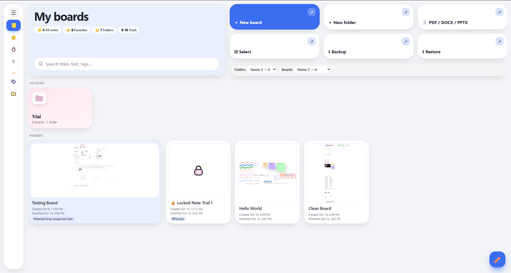 Home Section view

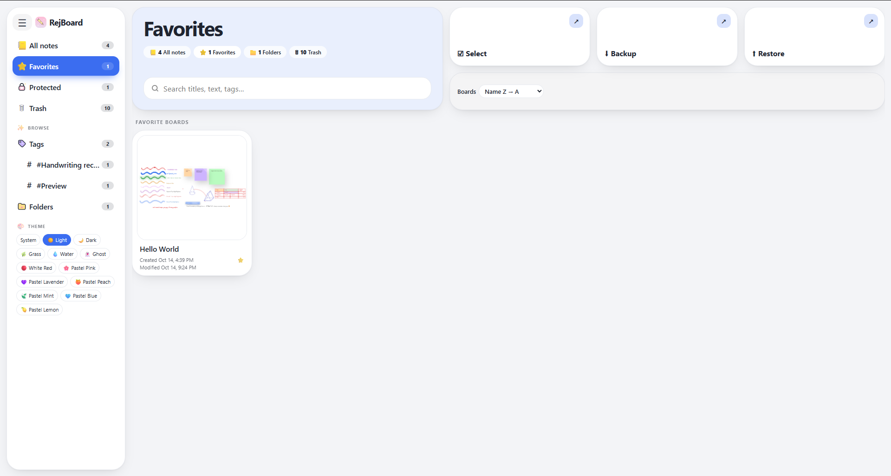 Favorite section view

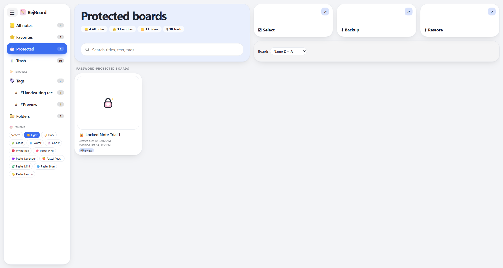 Protected section view

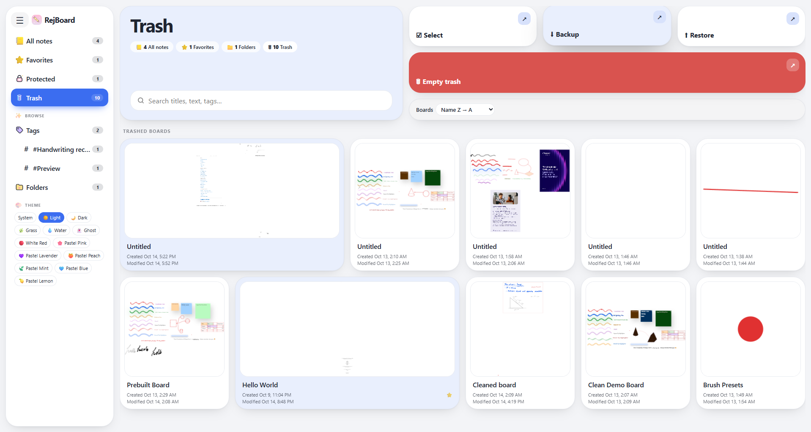 Trash section view

 Tag section view

</details>

<details>
<summary><b>Pens, highlighters, tapes and tools</b></summary>

- **Dock:** fountain, calligraphy (adjustable nib angle), soft brush, ballpoint, pencil, square / chisel / round highlighters, eraser, select, lasso, pan, laser pointer, text, sticky notes, shapes, emoji, images, undo / redo.
- **Presets** for pens, highlighters and tapes.
- **Tape** covers what is beneath it; click to reveal.
- **Laser pointer** with configurable fade time (0.2–5 s) and dot size.
- **Input:** pressure and tilt, palm rejection, stylus side-button eraser, Windows Ink / raw pointer mode for lower latency, coalesced pointer sampling with render-time curve smoothing.
- **Zoom** with buttons, Ctrl + wheel, pinch and Fit; **speed mode** for very large boards.

| Pens | Highlighters | Tapes |
|---|---|---|
| 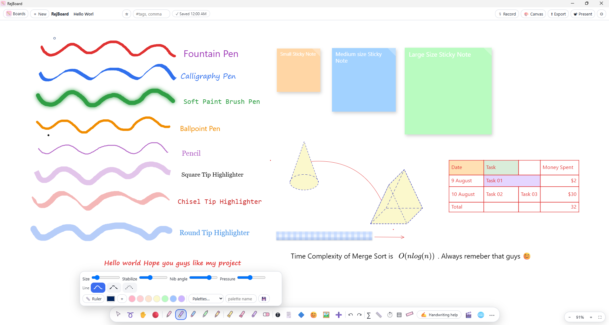 | 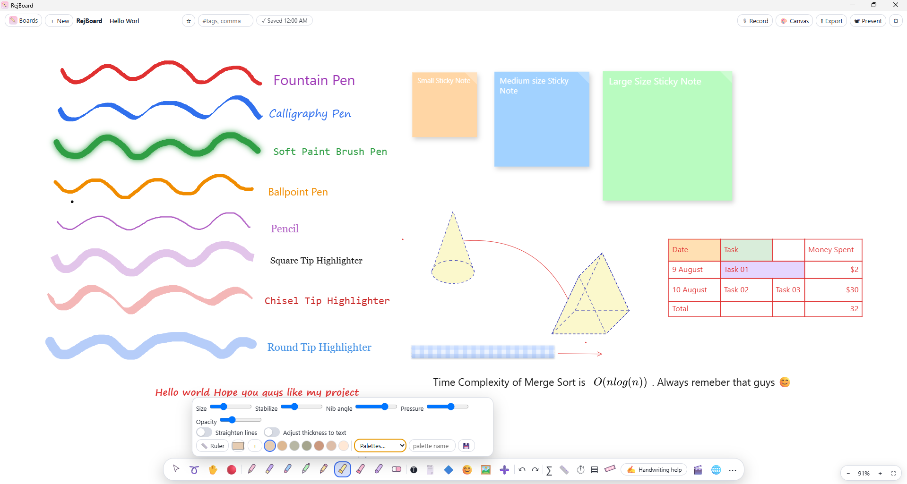 | 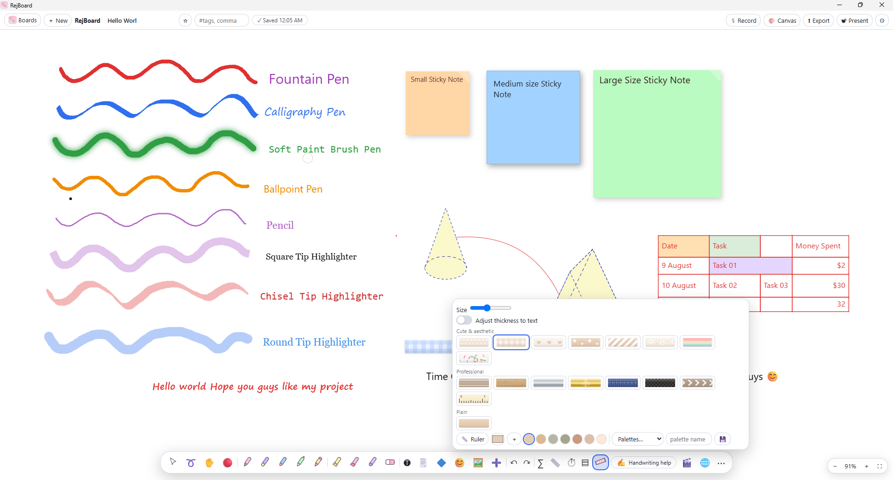 |

</details>

<details>
<summary><b>Selection, shapes and connectors</b></summary>

- **Selection:** click, box, lasso, Shift multi-select, 8-handle resize, rotation, duplicate, copy / cut / paste, group / ungroup, z-order, align, center and distribute. `Esc` clears the selection and cancels any active gesture.
- **Style bar** for selected objects: change a stroke's brush, size and line type; change a shape's line type, corner type, border width, border color and fill; recolor any mixed selection. All changes are undoable.
- **Sketch and snap** (off by default, toggle in settings): rough circles, ellipses, rectangles, triangles, diamonds, pentagons, hexagons, lines, curves and arrows become clean shapes.
- **Dynamic connectors:** lines and arrows attach to the true outline of a shape (including cones, stars, hearts and rotated shapes). Attached ends follow their shapes and bend into smooth S-curves.
- **Move connected shapes together** (setting, on by default): dragging a shape or connector moves everything linked to it. Hold **Alt** to move only the selection.
- **Layers:** add, rename, hide, lock, reorder, delete.
- **Transparent ruler** with a graduated scale and live angle readout. Rotate by dragging either end (Shift for 15° steps). Strokes started on the numbered edge draw perfectly straight lines.

</details>

<details>
<summary><b>Text, math and links</b></summary>

- Fonts (handwriting, sans, mono, marker, serif), bold / italic / underline, per-selection color. `Enter` finishes editing; `Shift+Enter` inserts a line break.
- **Math:** typed expressions like `sqrt(x^2+1)/2`, `a/b` and `int_0^1 x^2 dx` become LaTeX. Inline `$...$` previews while typing and becomes its own selectable, resizable object. A LaTeX palette covers structures, Greek, symbols and computer-science notation.
- **Board links:** type `@` to link to another board or to a specific page (`Notes › 3`). A **Back** button returns you across multiple hops, and linked boards show a *Linked from* indicator. Exports and shares can include linked boards.

</details>

<details>
<summary><b>Pages and paper</b></summary>

- **Canvas:** Infinite, or A4 / A5 / A3 / Letter in portrait or landscape. Pages stack vertically and drawing is clipped to the page.
- **Text stays on the page.** On paged canvases, long lines wrap at the page edge and overflow continues on the next page, for plain text, rotated text, sticky notes and formulas on every paper size.
- **Paper:** white, cream, gray, black, slate, navy; plain, grid, dots, lined, Cornell, columns, ruled with margin, isometric dots; adjustable spacing and mark size.
- **Automatic contrast:** switching paper recolors only the ink, shapes, text, stickies, formulas and table content that would become hard to read. Changes are non-destructive, so returning to the previous paper restores the original colors exactly.
- **Present mode:** fullscreen with laser pointer, spotlight, page navigation with smooth camera moves, zoom-to-selection, and timer / Pomodoro.

</details>

<details>
<summary><b>Tables and formulas</b></summary>

- Merge and split cells, resize rows and columns, fills, per-side borders (thickness, color, solid / dashed / dotted), alignment, and per-cell text style. Tab / Shift+Tab navigate cells.
- Typeset math inside cells with `$x^{2}$`, or with Auto-math enabled.
- Numbers right-align by default; `1,000`, `$5` and `50%` are read as numbers.

**Formulas** start with `=`. Cells use `A1` addressing, ranges use `A1:B5`, whole columns use `A:A`. Click cells while typing to insert references, or use **Σ Sum**. References follow cells when rows and columns are inserted or deleted.

| Category | Functions |
|---|---|
| Aggregate | `SUM` `AVERAGE` `MIN` `MAX` `COUNT` `COUNTA` `MEDIAN` `PRODUCT` |
| Conditional | `SUMIF` `COUNTIF` `AVERAGEIF` `IF` `IFERROR` `AND` `OR` `NOT` |
| Math | `ABS` `SQRT` `POWER` `MOD` `EXP` `LN` `LOG` `LOG10` `PI` `SIGN` |
| Rounding | `ROUND` `ROUNDUP` `ROUNDDOWN` `INT` `TRUNC` `FLOOR` `CEILING` |
| Text | `CONCAT` `LEN` `UPPER` `LOWER` `TRIM` `LEFT` `RIGHT` `MID` |
| Checks | `ISERROR` `ISNUMBER` |

Operators: `+ - * / ^ % &` and `= <> < > <= >=` (`^` is left-associative, as in Excel). Error values: `#DIV/0!` `#REF!` `#NAME?` `#VALUE!` `#CYCLE!` `#ERR!`.

</details>

<details>
<summary><b>PDF, Word and PowerPoint import</b></summary>

- **PDF:** choose pages and quality (dpi), arranged as a stack, row or grid. On infinite boards the pages become a locked layer; on fixed-size boards each page is fitted and centered on its own board page, adding pages as needed.
- **Word / PowerPoint / OpenDocument:** converted to PDF and imported as rendered pages. The desktop app uses LibreOffice if installed (headless), and falls back to Microsoft Office on Windows. The development `server.py` also uses LibreOffice.
- **Images:** insert onto the board, including by dragging from the in-app browser. Remote image fetches are limited to HTTP(S), image content types and 12 MB; if a site blocks the fetch, the URL is inserted as a link instead.

</details>

<details>
<summary><b>Export and backup</b></summary>

- **Formats:** PNG, SVG, PDF, selection as PNG, JSON, and `.rjwb` (RejBoard's own format, which includes recordings).
- **Infinite boards export as a single PDF page** containing everything. Bounds account for rotation and pen width, and very large boards lower pixel density instead of failing.
- **Linked boards:** when a board links to others you can include them. In PDF they follow page by page and links jump to the right page; in SVG they stack below with links between them.
- **Invert colors** (optional): inverts your ink, shapes, text, math and paper, but not imported content (images, PDF pages, imported documents).
- **Backup / Restore:** a single JSON file containing all boards and voice recordings.

</details>

<details>
<summary><b>Voice recordings</b></summary>

Press **🎙 Record** in the header to record while you write. Each board keeps its own recordings, with pause / resume, playback at 0.75×–2×, rename and delete. Recordings stay on your device, travel with `.rjwb` files, backups and local-network shares, and require microphone permission. Closing the app mid-recording discards that recording.

</details>

<details>
<summary><b>In-app browser and video (desktop)</b></summary>

- **Browser (🌐):** a compact, draggable panel with address / search, navigation, minimize, maximize and close. A right-click menu offers *Add image to board*, copy / save image, open or copy link, and text actions.
- **Video (🎬):** YouTube, Udemy, any video or livestream URL, or a local video file, with play / pause and ±10 s controls where the site exposes standard media elements.
- Embedded sites may block embedding, DRM, popups, third-party cookies or specific codecs. Compatibility and livestream smoothness depend on the site, your network, hardware and codecs.
- Requires Electron webviews, so it is **not** available in the web / PWA build.

</details>

### Shortcuts

| Action | Shortcut |
|---|---|
| Undo / Redo | `Ctrl+Z` / `Ctrl+Y` |
| Copy / Cut / Paste / Duplicate | `Ctrl+C` / `X` / `V` / `D` |
| Group / Ungroup | `Ctrl+G` / `Ctrl+Shift+G` |
| Save | `Ctrl+S` |
| Select all | `Ctrl+A` |
| Zoom | `+` / `-` |
| Fountain / Calligraphy / Soft brush / Ballpoint / Pencil | `1` / `2` / `3` / `4` / `5` |
| Square / Chisel / Round highlighter | `6` / `7` / `8` |
| Text / Tape / Eraser | `T` / `W` / `E` |
| Handwriting → text (only with handwriting selected) | `H` |
| Clear selection, cancel gesture | `Esc` |
| Move only the selection (ignore linked shapes) | Hold `Alt` while dragging |
| Constrain ruler rotation to 15° | Hold `Shift` |
| Present mode: change page | `←` `→` / `PageUp` `PageDown` |

On macOS, use `Cmd` in place of `Ctrl`.

### Gallery

| | |
|---|---|
| 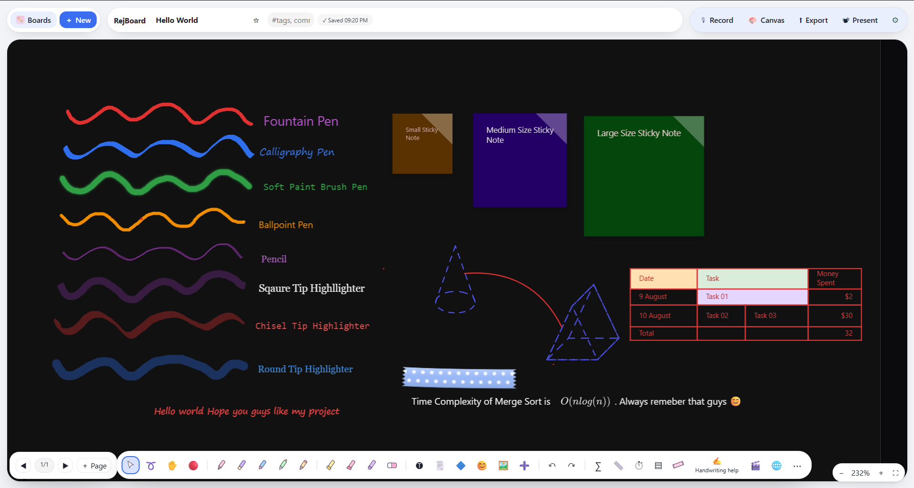 | 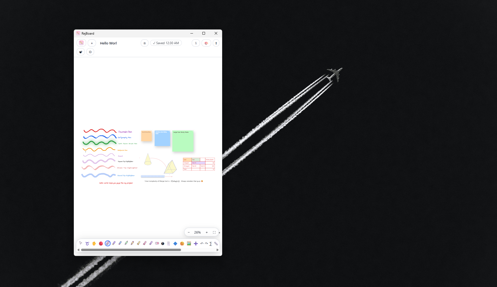 |
| *Dark paper with automatic ink contrast* | *Adapts to narrow, phone-sized windows* |
| 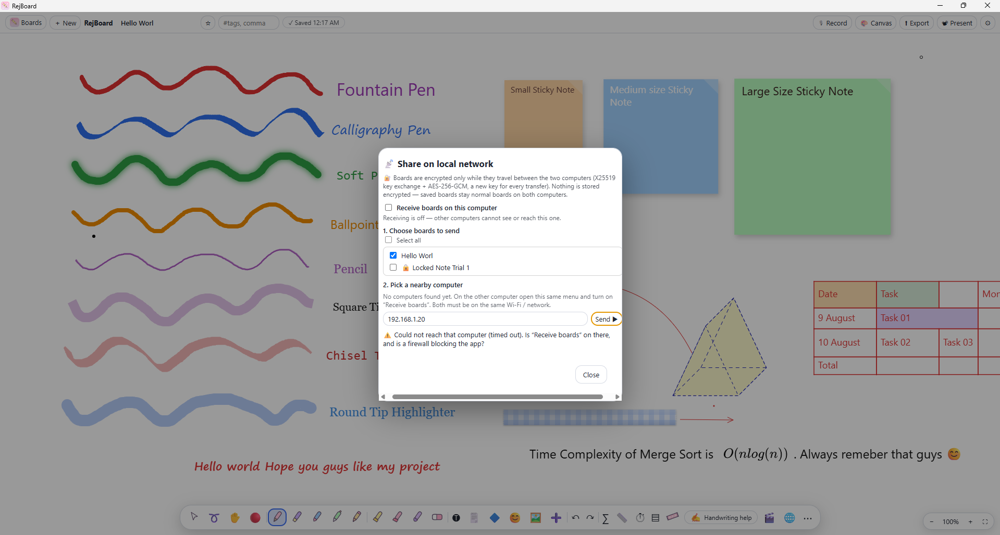 | 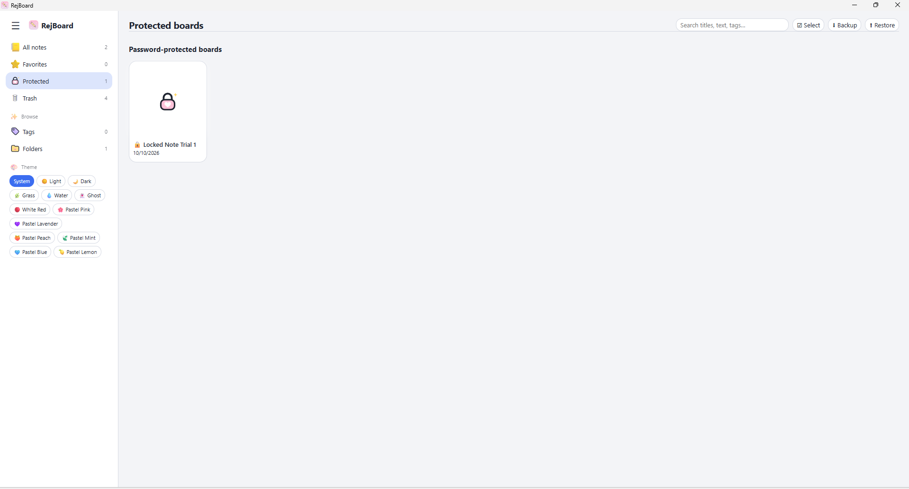 |
| *Encrypted LAN sharing with a confirmation code* | *Password-protected boards* |

---

## Architecture

RejBoard is intentionally dependency-light. The entire editor is a single static `index.html` that runs unchanged in a browser, as a PWA, and inside Electron. The desktop shell adds capabilities the browser cannot provide.

```
┌─────────────────────────── Renderer (index.html) ───────────────────────────┐
│  Canvas engine · tools · tables · math · PDF · export · i18n · IndexedDB    │
└───────────────▲─────────────────────────────────────────────▲───────────────┘
                │ window.wb (contextBridge, preload.js)        │ fetch / SW
┌───────────────┴──────────────── Electron main ──────────┐  ┌─┴────────────────┐
│ main.js   IPC handlers, doc→PDF, image fetch, i18n,     │  │  Web / PWA       │
│           ephemeral browser session                     │  │  sw.js offline   │
│ ocr.js    Tesseract.js worker (in-memory, one job)      │  │  cache           │
│ lan.js    UDP discovery + X25519/AES-256-GCM transfer   │  │  server.py (dev) │
└─────────────────────────────────────────────────────────┘  └──────────────────┘
```

| Component | Responsibility |
|---|---|
| `index.html` | The whole application: UI, canvas engine, storage, import / export. |
| `main.js` | Electron main process: window, IPC handlers, document conversion, remote image fetch, language packs, ephemeral browser session cleanup. |
| `preload.js` | The only bridge between renderer and main (`window.wb`), exposed through `contextBridge`. |
| `ocr.js` | On-device handwriting recognition: validates input (PNG only, 6 MB cap, one job at a time), runs a bundled Tesseract.js worker, releases it after 30 s idle. |
| `lan.js` | Local-network discovery and encrypted transfer. |
| `sw.js` + `manifest.json` | Offline cache and installability for the PWA. |
| `server.py` | Minimal local server for browser development, with a handwriting and document-conversion proxy. |
| `locales/` | Language packs keyed by the English source strings. |
| `vendor/` | Offline copies of MathJax, jsPDF and pdf.js (fetched, not committed). |
| `ocr-engine/` | Tesseract.js and language data, bundled into desktop builds as an extra resource. |

### Security posture (desktop)

- `contextIsolation: true`, `nodeIntegration: false`, `sandbox: true` on the main window.
- The renderer reaches the system only through the narrow, explicit API in `preload.js`.
- IPC inputs are validated: language-pack file names are pattern-matched, OCR input must be a PNG under the size cap, remote images are restricted by scheme, content type and size, and document conversion accepts a fixed set of extensions.
- New windows and external links are denied inside the app and opened in the system browser.
- Embedded browsing happens in a separate non-persistent session, cleared on close and on exit.

---

## Development

### Prerequisites

- **Node.js** 22 or newer and npm
- **Python** 3.9 or newer (for fetching offline libraries and for the dev server)
- Optional: LibreOffice, for Word / PowerPoint import

### Run in the browser

```bash
python fetch_libs.py     # one-time: MathJax, jsPDF, pdf.js (and OCR language data)
python server.py         # http://localhost:8000   (PORT=9000 python server.py to change)
```

### Run the desktop app

```bash
npm install
npm run libs             # one-time: offline libraries + bundled OCR engine
npm start
```

### Scripts

| Command | Purpose |
|---|---|
| `npm start` | Launch the Electron app from source. |
| `npm run libs` | Fetch `vendor/` libraries, download English OCR data, and install Tesseract.js into `ocr-engine/`. |
| `npm run test:ocr` | Smoke test of the bundled OCR path against `test/hello.png`. |
| `npm run dist` | Build installers for the current OS into `dist/`. |

### Repository layout

```
.
├── index.html            # the application
├── main.js  preload.js   # Electron main process and bridge
├── ocr.js  lan.js        # on-device OCR, LAN sharing
├── sw.js  manifest.json  # PWA
├── server.py             # local dev server
├── fetch_libs.py         # downloads vendor/ and OCR data
├── locales/              # 22 language packs + index.json
├── ocr-engine/           # Tesseract.js package + tessdata (fetched)
├── vendor/               # MathJax, jsPDF, pdf.js (fetched)
├── tools/                # string extraction and translation scripts
├── scripts/  test/       # OCR smoke test and fixture
├── build/                # app icons for packaging
├── Screenshots/          # README assets
└── .github/workflows/    # CI: installers and GitHub Pages
```

---

## Build and release

```bash
npm run dist
```

Installers are written to `dist/`. Build each OS on that OS. Artifacts are named `RejBoard-<version>-<os>-<arch>.<ext>`.

### Continuous integration

| Workflow | Trigger | What it does |
|---|---|---|
| **Build installers** (`build.yml`) | Push of a `v*` tag, or manual | Builds and publishes on Windows, macOS and Linux from matching `v*` tags. Verifies that the tag matches `package.json`, fetches offline libraries, runs the OCR smoke test, packages, and **verifies the OCR engine and language data are inside every package**. `electron-builder` publishes platform installers, update metadata and blockmaps to the same GitHub Release using `GITHUB_TOKEN`. |
| **Deploy web build** (`pages.yml`) | Push to `main`, or manual | Assembles the PWA with offline libraries and deploys it to GitHub Pages. |

### Cutting a release

1. Update `version` in `package.json`.
2. Add a `## [x.y.z]` section to `CHANGELOG.md`. The release job fails if it is missing.
3. Commit, then tag and push: `git tag vX.Y.Z && git push origin vX.Y.Z`.

---

## Localization

The interface is available in **22 languages**: English, العربية, বাংলা, 中文 (简体), Nederlands, Français, Deutsch, हिन्दी, Bahasa Indonesia, Italiano, 日本語, 한국어, فارسی, Polski, Português, Русский, Español, தமிழ், ไทย, Türkçe, اردو and Tiếng Việt. Arabic, Persian and Urdu switch the layout to right-to-left.

- Packs live in `locales/` and are keyed by the English source string, so no UI text is hard-coded per language. Missing strings fall back to English.
- The desktop app loads bundled packs first and only falls back to a download if one is missing. Downloaded packs can be removed in *Settings → Appearance → Downloaded language packs*.
- Text recognition and typing support covers 15 text languages (on-device recognition ships with English data by default).

### Translation quality

English is the source language. All other translations were generated with Meta AI's [NLLB-200 (`facebook/nllb-200-distilled-600M`)](https://huggingface.co/facebook/nllb-200-distilled-600M) and **have not been reviewed by native speakers**. Expect occasional inaccuracies or inconsistent terminology, especially in short labels with little context.

### Improving a translation

1. Fork the repository.
2. Edit `locales/<code>.json`. **Do not change the keys**, and keep placeholders such as `{name}` and `%s` intact.
3. Open a pull request describing your changes.

To regenerate strings, run `python tools/extract-strings.py` followed by `python tools/translate-packs.py`. If you would rather not edit files, open an issue listing the strings and your suggested replacements.

---

## Known limitations

- **No code signing.** Windows and macOS builds are unsigned (see [Installation](#installation)).
- **No cross-device sync.** By design. Use Backup, `.rjwb` files or LAN sharing to move boards.
- **Online handwriting recognition** depends on an unofficial Google endpoint that may change or stop working. Swap the `hw` handler in `main.js` and `recognize()` in `server.py` to use another engine.
- **On-device recognition** is tuned for neat, printed handwriting and is weaker on cursive.
- **Board passwords are an access gate**, not encryption at rest.
- **Embedded browsing and video** are subject to site, DRM and codec restrictions; the feature is desktop-only.
- **Legacy binary `.doc` / `.ppt`** import needs LibreOffice (or Microsoft Office on Windows).
- **Machine-translated UI strings** have not been reviewed by native speakers.

---

## Roadmap

- Android and iPadOS versions
- Native-speaker review of translations
- Additional on-device recognition languages
- Code signing and notarization for Windows and macOS

Ideas and priorities are tracked in [issues](https://github.com/RejwanShafi25/RejBoard/issues).

---

## Contributing

Contributions are welcome, especially translation fixes, bug reports with reproduction steps, and compatibility reports for pens and tablets.

1. Open an issue to discuss larger changes before starting.
2. Fork, create a branch, and keep changes focused.
3. Run `npm run test:ocr` if you touch the recognition path, and test the web build and the desktop app if you touch shared code in `index.html`.
4. Add an entry under **[Unreleased]** in `CHANGELOG.md`.
5. Open a pull request describing what changed and why.

When reporting a bug, please include your OS, the app version (see *Settings* or the installer name), whether you are using the desktop or web build, and your input device.

---

## License and credits

Released under the [MIT License](LICENSE).

RejBoard is built by **Rejwan Shafi**. Parts of the app were prototyped with AI assistance (Claude Sonnet and GPT Astra); the results were reviewed, corrected and optimized by hand.

**Third-party software:** [Electron](https://www.electronjs.org/), [electron-builder](https://www.electron.build/), [MathJax](https://www.mathjax.org/), [jsPDF](https://github.com/parallax/jsPDF), [pdf.js](https://mozilla.github.io/pdf.js/), [Tesseract.js](https://github.com/naptha/tesseract.js) and [Tesseract OCR data](https://github.com/tesseract-ocr/tessdata_fast). UI translations were machine-generated with Meta AI's [NLLB-200](https://github.com/facebookresearch/fairseq/tree/nllb).