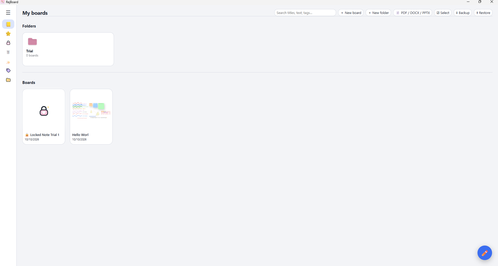
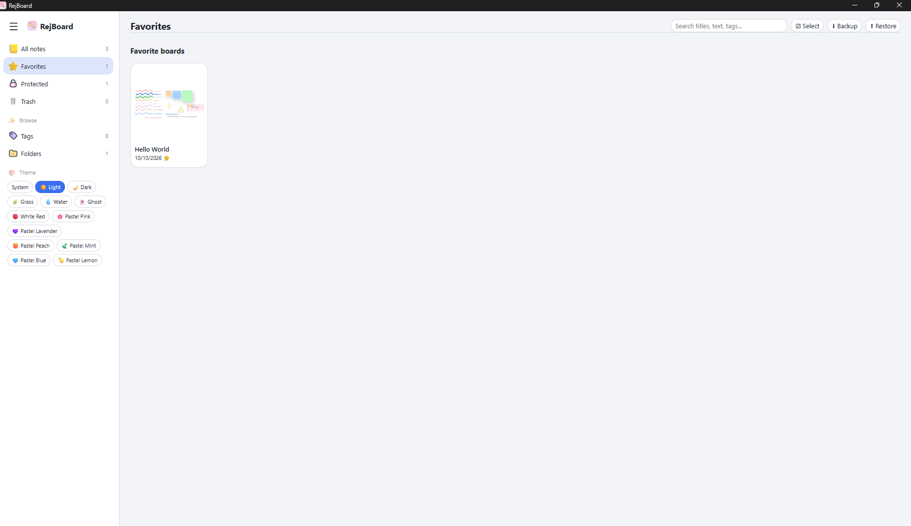
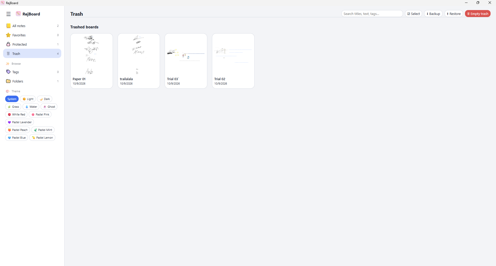

<div align="center">


# RejBoard

**A free, open-source, local-first whiteboard and handwriting note-taking app.**

Write by hand, sketch diagrams, annotate PDFs and record lectures. No account, no cloud, no subscription.
Your boards stay on your device.

[](https://github.com/RejwanShafi25/RejBoard/releases/latest)
[](LICENSE)


[**Download**](https://github.com/RejwanShafi25/RejBoard/releases/latest) ·
[**Try the web app**](https://rejwanshafi25.github.io/RejBoard/) ·
[Changelog](CHANGELOG.md) ·
[Report a bug](https://github.com/RejwanShafi25/RejBoard/issues)


</div>

<!--
DEMO VIDEO: once the video is uploaded, add it here, for example:

[](https://youtu.be/YOUR_VIDEO_ID)
-->

## Contents

- [Why RejBoard](#why-rejboard)
- [Highlights](#highlights)
- [Screenshots](#screenshots)
- [Install](#install)
- [Features in detail](#features-in-detail)
- [Offline use and privacy](#offline-use-and-privacy)
- [Share boards on your local network](#share-boards-on-your-local-network)
- [Keyboard shortcuts](#keyboard-shortcuts)
- [Languages](#languages)
- [Build from source](#build-from-source)
- [Project structure](#project-structure)
- [Releasing](#releasing)
- [Troubleshooting and FAQ](#troubleshooting-and-faq)
- [Roadmap](#roadmap)
- [Contributing](#contributing)
- [License](#license)
- [Credits and AI disclosure](#credits-and-ai-disclosure)

## Why RejBoard

I take most of my notes by hand on an Android tablet. There is no shortage of handwriting apps there, and each one does something well: one has an excellent pen engine, another has good organization tools, a third handles PDFs cleverly. The problem is that the best features are usually behind a paywall or a subscription, buying every app would cost far more than I was willing to spend, and most of them keep your notes in their own cloud.

I wanted something different: a handwriting note-taking app that is **free, open source and fully local**, where your notes live on your device and nowhere else, and that also runs on Windows, where there are few handwriting-first note apps apart from OneNote.

To get there, I studied the most useful features of note-taking apps on Android, iPadOS (which I tested for a few days) and Windows, and set out to bring them together in one app.

### Principles

- **Local-first.** No account, no cloud sync, no analytics. Boards are stored on your own device.
- **Free and open source.** No subscriptions and no paywalled features (MIT license).
- **Handwriting first.** A fast, pressure-sensitive pen, with typed text, math, shapes, tables and diagrams alongside it.

### Where it stands

RejBoard is built with Electron and ships installers for **Windows, macOS and Linux**, plus an installable offline web app (PWA). The desktop app is the current focus. Android and iPadOS versions are planned but will take time (see [Roadmap](#roadmap)).

> **Internet use.** RejBoard works offline. A few optional features need a connection: online handwriting-to-text recognition (a Google service), the in-app browser and video panel, and the one-time download of a language pack. See [Offline use and privacy](#offline-use-and-privacy).

## Highlights

| | |
|---|---|
| **Handwriting** | Fountain, calligraphy, brush, ballpoint, pencil and three highlighters; pressure, tilt shading, palm rejection, stylus side-button eraser, Windows Ink mode |
| **Diagrams** | Sketch-and-snap shapes, dynamic connectors, sticky notes, layers, a rotatable transparent ruler |
| **Text and math** | Rich text, typed math that becomes LaTeX, manual LaTeX palette, handwriting-to-text (online or on-device) |
| **Tables** | Merged cells, borders, cell colors, per-cell text style, spreadsheet-style formulas |
| **Documents** | Annotate PDFs, import DOCX/PPTX as editable text, export PNG / SVG / PDF |
| **Organization** | Folders, tags, favorites, password-protected boards, trash, search, sorting, `@` links between boards |
| **Recording** | Per-board voice recordings while you write |
| **Study tools** | Present mode with laser pointer and spotlight, Pomodoro timer, in-app browser and video panel (desktop) |
| **Sharing** | Encrypted board transfer over your local network, no server involved |
| **Languages** | Interface in 22 languages, right-to-left layouts included |

## Screenshots

### Everything on one board


*Handwriting, shapes, sticky notes, text and LaTeX formulas on a single board.*


*The same board on dark paper. Ink colors adjust automatically when the paper changes.*

### Home screen






*A boards grid with folders, tags, favorites, password-protected boards and a Trash.*

### Pens, highlighters and tapes


*Adjustable presets for pens, highlighters and tapes.*

### Share on your local network


*Send boards to another computer on the same network, encrypted, with a confirmation code.*

### Works at any window size


*The dock, page navigator and header adapt to maximized, windowed and phone-sized windows.*

<!--
Add these back once the files are committed to Screenshots/ (they were referenced in the previous README):

04-handwriting-to-text.gif   Handwritten words turned into typed text
05-shapes.gif                Rough shapes snapping to clean shapes with connectors
06-pages.gif                 Text wrapping onto the next A4 page
07-pdf.png                   Annotated PDF
08-tables.png                Table with merged cells and a SUM formula
09-links.png                 @ link picker and a linked board
10-recordings.png            Recording panel next to notes
11-ruler.gif                 Drawing a straight line along the ruler
12-browser.png               In-app browser panel beside a board
13-lan.png                   Local network sharing with a security code
-->

## Install

### Desktop app (Windows, macOS, Linux)

Download the installer for your system from the [latest release](https://github.com/RejwanShafi25/RejBoard/releases/latest):

| System | Files |
|---|---|
| Windows (x64) | `RejBoard-<version>-win-x64-Setup.exe` (installer) or `-Portable.exe` |
| macOS (Intel and Apple Silicon) | `RejBoard-<version>-mac-*.dmg` |
| Linux | `.AppImage`, `.deb`, `.rpm` |

> **Unsigned builds.** The installers are not code-signed yet.
> - **Windows:** SmartScreen may warn. Choose **More info → Run anyway**.
> - **macOS:** if macOS says the app is damaged, run `xattr -cr "/Applications/RejBoard.app"` once.

### Web app (PWA)

Open <https://rejwanshafi25.github.io/RejBoard/>, then in Chrome or Edge click the install icon in the address bar to install it as an offline app. Boards are stored in your browser, so they are not shared between devices.

The desktop-only features (in-app browser and video panel, on-device handwriting recognition, local network sharing) are not available in the web build.

### Where are my boards stored?

- **Desktop:** in the app's own data folder. If an older "Rejwan Whiteboard" data folder exists, RejBoard keeps using it so existing boards carry over.
- **Web:** in the browser's IndexedDB, not the cache. Clearing only "cached images and files" is safe. Clearing "cookies and other site data" **deletes your boards**.

Use **Backup** on the home screen regularly.

Current version: **1.2.8** (see [CHANGELOG.md](CHANGELOG.md)).

## Features in detail

### Home screen

- Boards grid with thumbnails, search (titles, text and `#tags`), PDF import, backup and restore.
- **Sidebar:** All notes · Favorites · Protected · Trash, then Tags and Folders.
- **Folders** nest without limit. Hover a folder card to rename, recolor, add a subfolder or delete it (contents move up one level). Drag boards onto a folder to move them. Folders are shown as a 5×5 paged grid with a breadcrumb.
- **Board ⋮ menu:** favorite, copy, move (tree picker), edit tags, lock with a password, move to Trash. Locked boards show a blurred thumbnail, are listed under **Protected**, and ask for the password before opening.
- **Tags** can be added from the ⋮ menu or the board header. The Tags page lists every tag and its boards.
- **Select multiple boards** (☑ Select) to favorite, move, tag, trash or share several at once. In Trash you can restore or permanently delete in bulk. Permanently deleting a board also deletes its recordings.
- **Created and modified dates** on every card. *Modified* changes only when you edit content or the title, not when you open, favorite, move or lock a board.
- **Sorting:** boards by name, date created or date modified; folders by name. Your choice is remembered.

### Drawing and tools

- **Tool dock:** fountain, calligraphy (adjustable nib angle), soft brush, ballpoint, pencil, square / chisel / round highlighters (opacity, nib angle), eraser, select, lasso, pan, laser pointer, text, sticky notes, shapes, emoji, images, undo/redo.
- **Select tools:** click, box-select, lasso, Shift-click multi-select, 8-handle resize, rotation, move, duplicate, copy/cut/paste, delete, group/ungroup, bring to front / send to back, align, center, distribute. Clicking a group member selects the whole group. **Esc** or the **Deselect** button clears the selection and cancels an active gesture.
- **Style bar for selections:** change the brush, size and line type of strokes; line type, corner type, border width, border color and fill of shapes; and the color of any mix of objects. Every change can be undone.
- **Sketch & snap** ("Fix shapes", on by default): rough circles, ellipses, rectangles (also rotated), squares, triangles, diamonds, pentagons, hexagons, straight lines, curves and arrows become real shapes.
- **Dynamic connectors:** Line / Arrow / Double arrow can be curved (drag the orange handle, double-click to straighten). Drag an end onto a shape's edge to attach it (green ring); attached ends follow the shapes.
- **Sticky notes** in three sizes and pastel colors, **shapes** (flat, 3D, axes) with a live preview, and **emoji**.
- **Layers:** add, rename, hide, lock, reorder, delete.
- **Tape:** covers what is beneath it; click to reveal. Cute and professional designs.
- **Transparent ruler:** graduated scale with a live angle readout. Rotate by dragging either end handle (Shift for 15° steps), move by the center grip. Start a pen or highlighter stroke along the numbered edge to draw a perfectly straight line.
- **Laser pointer:** double-click the tool to set the trail fade time (0.2 to 5 s) and dot size.
- **Zoom** (buttons, Ctrl+wheel, pinch, Fit), **speed mode** for large notes, **palm rejection**, **tilt shading**, stylus side-button eraser and a Windows Ink / raw pointer mode for lower-latency input where Chromium provides it.
- **Smoother ink:** every coalesced pointer sample is used, redraws happen once per frame, and the eraser sweeps the gaps between samples.
- **Autosave** with a live indicator (● Saving… → ✓ Saved).
- **Responsive layout:** the dock, page navigator and zoom controls stay on one row when there is room and wrap onto two rows when there is not. The dock shrinks its icons before it ever scrolls.

### Text and math

- Fonts (handwriting, sans, mono, marker, serif), bold/italic/underline, text color and partial-selection formatting. **Enter** finishes editing, **Shift+Enter** inserts a line break.
- **Typed math** such as `sqrt(x^2+1)/2`, `a/b` or `int_0^1 x^2 dx` becomes a LaTeX formula (the **Auto-math** toggle controls this). Inline `$...$` is previewed while typing, and `text $O(n)$ more text` turns only `$O(n)$` into a formula object you can select, move, resize and rotate.
- **Manual LaTeX tool** with a palette of structures, Greek letters, symbols and computer-science symbols.
- **Handwriting to text:** lasso-select handwriting and press **✍→T**. Two engines (⚙ Settings → *Handwriting to text*):
  - **Online (Google), default.** Sends only the ink points to a Google handwriting service. Best for cursive. Needs an internet connection.
  - **On-device (offline), desktop only.** No network, no API key, nothing written to disk. The selected strokes are drawn to a small black-on-white image in memory, passed to the operating system's OCR engine, and discarded: Apple Vision on macOS, Windows.Media.Ocr on Windows, Tesseract on Linux. These engines suit neat or printed handwriting and are weaker on cursive. **Linux packages bundle Tesseract.js with English data**, so on-device recognition works with nothing to install. If the system `tesseract` command exists it is used first, which also covers other languages.
  - Recognized text that looks like math becomes a formula.

### Pages and paper

- **Canvas:** Infinite (default) or A4 / A5 / A3 / Letter in portrait or landscape. Pages stack vertically and drawing is clipped to the page.
- **Text stays on the page.** On paged canvases, long lines wrap at the right edge and overflowing text continues at the top of the next page (a page is added when needed). This covers plain text, rotated text, sticky notes, and text containing formulas.
- **Paper:** white, cream, gray, black, slate, navy; plain, grid, dots, lined, Cornell, columns, ruled with margin, isometric dots; spacing and mark-size sliders.
- **Automatic contrast:** when you change the paper color, only the colors that would become hard to read (ink, shapes, tape, text, sticky notes, formulas, table text and borders) are adjusted, keeping their hue where possible.
- **Present mode:** fullscreen, dock stays visible, laser pointer, spotlight, timer. Arrow keys or PageUp/PageDown change pages with a smooth camera move. A zoom-to-selection shortcut and a Pomodoro timer are included.

### Tables

- Insert from ➕ → Table (3×3). Select cells by dragging (Shift+click extends). Resize rows and columns by dragging a grid line; the ✥ handle moves the table.
- **Merge / split** cells, **cell background**, **borders** (all, outer, inner, top, bottom, left, right, none) with thickness, color and Solid / Dashed / Dotted style, and **alignment**. Text wraps inside cells. **Tab / Shift+Tab** moves between cells, **Enter** moves down.
- **Per-cell text style:** font, size, color, bold/italic/underline, with **Reset** and **All cells**. Rows grow automatically so text is never clipped.
- **Math in cells:** `$x^{2}$` is typeset when you finish editing; with Auto-math on, `x^2/3` also becomes an equation. The LaTeX dock button inserts into the selected cell.
- Numbers right-align by default; `1,000`, `$5` and `50%` are read as numbers.

#### Table formulas

Start a cell with `=`. Cells are `A1`-style, ranges are `A1:B5`, whole columns are `A:A`. Address labels appear on the selected table, and while typing a formula you can click cells to insert references (Shift+click for a range). The **Σ Sum** button fills in `=SUM(...)`. Formulas follow their cells when rows or columns are inserted or deleted.

- **Operators:** `+ - * / ^ % &` and comparisons `= <> < > <= >=` (`^` is left-associative, like Excel).
- **Functions:** SUM AVERAGE MIN MAX COUNT COUNTA MEDIAN PRODUCT ABS SQRT POWER MOD ROUND ROUNDUP ROUNDDOWN INT TRUNC FLOOR CEILING SIGN EXP LN LOG LOG10 PI IF AND OR NOT IFERROR ISERROR ISNUMBER SUMIF COUNTIF AVERAGEIF CONCAT LEN UPPER LOWER TRIM LEFT RIGHT MID.
- **Errors:** `#DIV/0!` `#REF!` `#NAME?` `#VALUE!` `#CYCLE!` `#ERR!`.

### Linked boards

- Type **`@`** inside a text or sticky note to open a picker of your boards. Click one, or keep typing its name and press Enter/Tab. The link appears as a blue underlined `@Board name`.
- **Link to a single page** of a multi-page board (for example "Notes › 3").
- If no board matches the name you typed, the picker offers **➕ Create board**.
- Click a link (Select, Lasso, Hand or Laser tool, or Ctrl/Cmd+click with any tool) to open it. A **← Back** button returns you to the previous board, across several hops.
- Boards that others link to show **🔗 Linked from …** beside their name.
- **Saving a copy or sending over the network** can take linked boards along. The receiver sees a picture of each, can untick any, and saves the rest in one step; links are re-pointed to the new copies automatically.

### Importing and exporting

- **PDF import:** choose pages and quality (dpi) and arrange them as a stack, row or grid. On Home or in an infinite note the pages become a locked layer. In a fixed-size note each PDF page is scaled to fit its own page.
- **DOCX / PPTX import** as editable text (legacy `.doc` / `.ppt` must be converted first). **Images** can be inserted onto the board.
- **Export:** PNG, SVG, PDF, selection as PNG, JSON, and **Save a copy** (`.rjwb`, which only RejBoard opens). An infinite board exports as a single PDF page containing everything; very large boards lower the pixel density instead of failing.
- **Linked boards in PDF and SVG:** you are asked whether to include them. In a PDF they follow the first board, and a link jumps to the page it names. In an SVG they sit below, with a link back. Password-protected boards ask for their password first.
- **Invert colors** (optional) inverts ink, shapes, text, math and paper, but not imported images, PDF pages or imported Word/PowerPoint text. Documents imported before v1.2.3 are not tagged as imported; re-import them to protect them.

### Voice recordings

**🎙 Record** in the top bar: record a lecture while you write, pause and resume, and keep several recordings per board. Play, seek, change speed (0.75× to 2×), rename or delete them later. Recordings stay on your device, belong to one board, and are included in Backup / Restore, Save a copy and local network sharing. Needs microphone permission. Closing the app mid-recording discards that recording.

### In-app browser and video (desktop only)

- **Browser (🌐):** a compact, draggable panel with address/search, back, forward, reload, minimize, maximize/restore and close.
- **Video (🎬):** YouTube, Udemy, an online video or livestream URL, or a local video file. Play/pause and ±10-second controls appear where the site exposes standard HTML media elements.
- **Right-click menu:** *Images:* add to board, copy image, copy image address, save image as. *Links:* open here, copy link address. *Selected text:* copy, search Google. *Text fields:* cut, copy, paste, select all. Also back, forward and reload.
- The address bars behave like any text field (**Ctrl+A** selects the whole URL), and only one popup is open at a time.
- **Dragging images** from a site attempts to fetch the image and insert it as an image object. Some sites block this, require authentication or use expiring URLs; the URL is then inserted as a link. Fetches are limited to HTTP(S), image content types and 12 MB.
- **Udemy:** sign in on Udemy's own page inside the panel to open your courses. Site-specific login, DRM, popups and codecs are controlled by the site and Chromium, so not every site or stream is guaranteed to work.

### Settings

⚙ opens appearance (language, downloaded language packs, themes), inking, canvas, reset to default, and boards. Every button has a hover tooltip.

## Offline use and privacy

RejBoard stores boards, recordings and settings on your device. There is no account, no cloud sync and no analytics. These optional features use the internet:

| Feature | Needs internet? | What is sent |
|---|---|---|
| Handwriting to text, **Online** engine | Yes | The selected strokes, to a Google handwriting service (an unofficial Google Input Tools endpoint) |
| Handwriting to text, **On-device** engine | No | Nothing |
| In-app browser and video panel (desktop) | Yes | Whatever you browse |
| Language packs | Once per language | A one-time download of the pack file from this repository; nothing about you is sent |
| Drawing, text, math, tables, PDF, export, recordings, local network sharing | No | Nothing leaves your device (local sharing stays on your LAN) |

### Browser privacy and data handling

The embedded Browser and Video panels use a **non-persistent Electron session** (no `persist:` partition). RejBoard does not write the panel's typed addresses, search phrases, browsing history, form values, keyboard events, mouse interactions or login credentials into its board database, localStorage or preferences. Closing a panel releases its local video object URL and clears the temporary session, which is also cleared when RejBoard exits.

Electron runs with `contextIsolation` and `sandbox` enabled and Node integration disabled; only the `webview` tag is turned on for the panels.

**Limits.** This is not an anonymity guarantee. A website can receive your IP address and normal connection metadata, and may store searches, account activity and cookies on its own servers. While a panel is open, cookies and site storage can be used in memory so you can sign in and navigate. Do not use the feature on a device you do not trust, and sign out of accounts before closing if you wish. Some sites block embedded contexts, DRM playback, popups, third-party cookies or specific codecs, and livestream performance depends on the site, network, hardware and codecs.

## Share boards on your local network

Menu **Export / Save ▸ 📡 Share boards on local network**. Works between Windows, macOS and Linux computers on the same Wi-Fi or LAN, both running the desktop app.

1. On the receiving computer, turn on **Receive boards on this computer**.
2. On the sending computer, tick the boards, pick the computer from the list (or type its IP address) and press **Send**. A live progress bar shows the transfer.
3. Both screens show the same 6-digit security code. The receiver checks that it matches and presses **Accept**.

Received boards land in a folder called *Received from <computer>*.

**Encryption** applies in transit only. Every transfer performs a fresh X25519 key exchange and sends data with AES-256-GCM; the confirmation code protects against a man-in-the-middle. Boards are never stored encrypted. Receiving is **off by default** and nothing is announced on the network until you turn it on. The first time, your OS firewall may ask to allow the app on private networks (UDP 41234 for discovery, TCP 41235 for transfer). Allow it.

## Keyboard shortcuts

| Action | Shortcut |
|---|---|
| Undo / Redo | Ctrl+Z / Ctrl+Y |
| Copy / Cut / Paste / Duplicate | Ctrl+C / Ctrl+X / Ctrl+V / Ctrl+D |
| Group / Ungroup | Ctrl+G / Ctrl+Shift+G |
| Save | Ctrl+S |
| Select all (canvas) or all text (text fields, URL bars) | Ctrl+A |
| Delete selection | Delete |
| Zoom | + / − or Ctrl+wheel |
| Clear selection, cancel gesture | Esc |
| Present mode: change page | ◀ ▶, PageUp / PageDown |

(On macOS use Cmd in place of Ctrl.)

## Languages

The interface is available in **22 languages** (English is the default): English, العربية (Arabic), বাংলা (Bengali), 中文 (Chinese, Simplified), Nederlands (Dutch), Français (French), Deutsch (German), हिन्दी (Hindi), Bahasa Indonesia (Indonesian), Italiano (Italian), 日本語 (Japanese), 한국어 (Korean), فارسی (Persian), Polski (Polish), Português (Portuguese), Русский (Russian), Español (Spanish), தமிழ் (Tamil), ไทย (Thai), Türkçe (Turkish), اردو (Urdu) and Tiếng Việt (Vietnamese). Arabic, Persian and Urdu switch the layout to right-to-left. Text recognition and typing support covers 15 text languages.

Choose a language in **Settings → Appearance → Language**. Its pack is downloaded once from `locales/` in this repository, saved on your device and used offline from then on, in both the desktop and web apps. Untranslated strings fall back to English. Delete packs under *Settings → Appearance → Downloaded language packs*.

### A note on translation quality

English is the source language. All other translations were generated with Meta AI's [`facebook/nllb-200-distilled-600M`](https://huggingface.co/facebook/nllb-200-distilled-600M) machine translation model and have **not yet been reviewed by native speakers**. Expect occasional inaccuracies, awkward phrasing or inconsistent terminology, especially in short labels where context is limited. Strings that contain changing values (for example "Grouped N objects") stay in English for now.

### Contributing translations

Native and fluent speakers are the most valuable contributors here.

1. Fork the repository.
2. Open `locales/<code>.json` for your language (the keys are the English strings).
3. Correct the translated values. **Do not change the keys**, and keep placeholders such as `{name}` or `%s` unchanged.
4. Open a pull request with a short description.

Prefer not to edit files? Open an issue listing the strings and your suggested replacements. Maintainers can rebuild and fill packs with `python tools/extract-strings.py` and `python tools/translate-packs.py`.

## Build from source

**Requirements:** Node.js 22 and Python 3 (the CI uses Node 22 and Python 3.12).

| Goal | Steps |
|---|---|
| **Web app, quickly** | `python server.py`, then open <http://localhost:8000> |
| **Desktop app (development)** | `npm install` → `python fetch_libs.py` (one time, downloads the offline LaTeX/PDF libraries into `vendor/`) → `npm start` |
| **Desktop installers** | `npm run dist`; installers appear in `dist/`. Build each OS on that OS. |
| **Linux with bundled OCR** | `npm install && npm run libs:linux`, then `npm start` or `npm run dist` |
| **OCR smoke test** | `npm run test:ocr` |

`vendor/` is git-ignored, so run `python fetch_libs.py` after a fresh clone. Without it, formulas and PDF features will not work offline.

The server (`server.py`) serves the app and acts as the handwriting proxy in the browser; in the desktop app the same job is done by the Electron main process.

## Project structure

```
index.html            The whole app (UI, canvas engine, logic)
main.js               Electron main process (window, handwriting proxy, browser panel, context menu)
preload.js            Electron preload bridge (context-isolated)
lan.js                Local network discovery and encrypted transfer
ocr.js                On-device handwriting recognition (Vision / Windows OCR / Tesseract)
server.py             Local static server and handwriting proxy for the browser
manifest.json, sw.js  PWA manifest and offline service worker
fetch_libs.py         Downloads MathJax, jsPDF and pdf.js into vendor/
locales/              Language packs (<code>.json) and index.json
tools/                extract-strings.py, translate-packs.py
ocr-linux/            Bundled Tesseract.js for Linux builds
scripts/              ocr-smoke.js
build/                App icons for installers
Screenshots/          Images used by this README
.github/workflows/    build.yml (installers and releases), pages.yml (web deploy)
```

## Releasing

Releases are automated with GitHub Actions.

1. Bump `version` in `package.json`.
2. Add a `## [x.y.z]` section to `CHANGELOG.md`. The release job copies this section into the release notes and **fails if it is missing**.
3. Commit, then push a tag that matches the version, for example `git tag v1.2.8 && git push origin v1.2.8`. The workflow checks that the tag equals `package.json`'s version.
4. `build.yml` builds Windows, macOS and Linux installers, verifies the bundled OCR on Linux, and publishes a GitHub Release with all files attached.
5. Every push to `main` deploys the web build to GitHub Pages (`pages.yml`). When the web files change, bump the cache name in `sw.js` so installed PWAs update.

## Troubleshooting and FAQ

**Handwriting-to-text does nothing.** The default engine is online. Check your connection, or switch to the on-device engine in Settings (desktop only; best for neat or printed writing).

**A website will not load or play in the browser panel.** Some sites block embedded contexts, DRM or specific codecs. Try the site's own share or open options, or use a local video file.

**My language does not translate.** The pack is downloaded on first use, so connect once, pick the language, and it works offline afterwards.

**Local network sharing cannot find the other computer.** Both computers must run the desktop app on the same network, and the receiver must have *Receive boards on this computer* turned on. Allow the app through the firewall on private networks (UDP 41234, TCP 41235), or type the receiver's IP address.

**Linux on-device recognition says Tesseract is missing.** Official Linux packages bundle it. For a source build run `npm run libs:linux`, or install it with `sudo apt install tesseract-ocr`.

**The microphone does not record.** Allow microphone permission for RejBoard in your operating system's privacy settings.

**I cleared my browser data and lost boards (web app).** Boards live in IndexedDB. Clearing "cookies and other site data" deletes them. Use **Backup** regularly.

## Roadmap

- Android and iPadOS versions (planned, no date)
- Native-speaker review of the translations
- Code-signed Windows and macOS builds

Ideas and bug reports are welcome in the [issue tracker](https://github.com/RejwanShafi25/RejBoard/issues).

## Contributing

Bug reports, translation fixes and pull requests are welcome. For a code change, please open an issue first to discuss it, keep the change focused, and describe how you tested it (platform, input device, window size). For translations, see [Contributing translations](#contributing-translations).

## License

[MIT](LICENSE) © 2026 Rejwan Shafi

## Credits and AI disclosure

RejBoard is built by **Rejwan Shafi**.

AI coding assistants (Claude Sonnet from Anthropic and ChatGPT from OpenAI) were used during development, including to prototype parts of the app. AI-generated code was not accepted as-is: I reviewed it, found flaws and inefficiencies, and corrected them. I am responsible for the final result, and bug reports are the fastest way to help me improve it.

UI translations were machine-generated with Meta AI's [NLLB-200](https://github.com/facebookresearch/fairseq/tree/nllb) (`facebook/nllb-200-distilled-600M`) and are open to community improvement.

Third-party libraries bundled for offline use: [MathJax](https://www.mathjax.org/), [jsPDF](https://github.com/parallax/jsPDF), [pdf.js](https://mozilla.github.io/pdf.js/), and [Tesseract.js](https://github.com/naptha/tesseract.js) (Linux builds).
